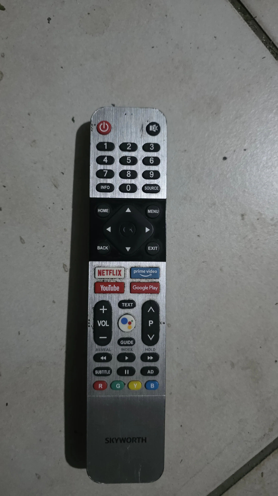

# Skyworth SWTV-20AE remote

The BLE remote: vendor 1d5a, product c580, "TV BLE Remote Consumer Control".

Layout, top to bottom:
- Power, Mute
- 1-9, then Info, 0, Source
- Home, Menu, the arrows with OK, Back, Exit
- Netflix, Prime Video, YouTube, Google Play
- Vol +/-, Text, Google Assistant (mic), Guide, P up/down
- Rewind (Reveal), Play (Index), Fast forward (Hold)
- Subtitle, Pause, AD
- R, G, Y, B

Results from the button test (2026-11-14). "Home sees it" means the launcher gets the key and it can be remapped:

| Button | Android key | Scancode | Result |
|---|---|---|---|
| OK | DPAD_CENTER 23 | 353 | home sees it |
| Info | INFO 165 | 358 | home sees it, free |
| Guide | GUIDE 172 | 439 | home sees it, free |
| Red | PROG_RED 183 | 398 | home sees it, free |
| Green | PROG_GREEN 184 | 399 | home sees it, free |
| Yellow | PROG_YELLOW 185 | 401 (raw KEY_BLUE) | home sees it, free |
| Blue | PROG_BLUE 186 | 400 (raw KEY_YELLOW) | home sees it, free |
| Play | MEDIA_PLAY 126 | 207 | home sees it |
| Pause | MEDIA_PAUSE 127 | 119 | home sees it |
| Rewind | MEDIA_REWIND 89 | 168 | home sees it |
| Fast forward | MEDIA_FAST_FORWARD 90 | 208 | home sees it |
| Subtitle | FUNCTION 119 | 206 | home sees it. Wrong code from Skyworth (should be CAPTIONS 175), which is why apps ignore it |
| Exit | BACK 4 | 174 | home sees it, but it is the same key as Back, so it can't be remapped on its own |
| AD | FUNCTION 119 | 519 (raw KEY_NUMERIC_7) | home sees it, but same Android key as Subtitle; only the scancode differs |
| P up | CHANNEL_UP 166 | 402 | home sees it, free on Home (no live TV in use) |
| Netflix | raw KEY_CALENDAR | | system opens Netflix |
| YouTube | raw KEY_BRIGHTNESS_MIN | | system opens YouTube |
| Prime Video | raw KEY_CANCEL | | system opens Prime Video (slow to start) |
| Google Play | raw KEY_VCR | | system opens the Play Store first |
| Text | raw KEY_BRL_DOT4 | | nothing gets it |
| Mic (Assistant) | raw KEY_SEARCH | | system takes it. Google voice search is disabled, so it goes nowhere |
| Menu | raw KEY_MENU | | system (Skyworth quick menu) |
| Source | raw KEY_CD | | system (input picker) |
